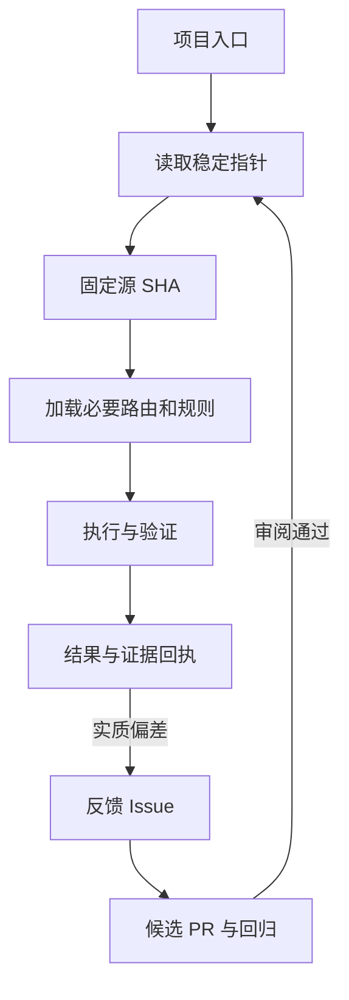

# project-router

在一个 Git 仓库维护 ChatGPT Work 各项目的路由、工作流、规则和 skills。每个项目只保留短入口，任务开始时读取已发布快照。

首版提供“新项目脑暴”和“内容创作”两条路由，以及四个指令型 skills。源代码和配置采用 MIT 许可证。

## 开始使用

1. 在目标 ChatGPT 项目中确保 GitHub 连接可以读取 `hilt21/project-router`。
2. 将下列入口文件的**正文**复制到对应项目的指令设置中：
   - [新项目脑暴入口](bootstrap/new-project.md)
   - [内容创作入口](bootstrap/content-studio.md)
3. 新建该项目内的 Work 对话，发送一个真实任务。首个回执应包含实际源 SHA、已读 skills 和未验证项。

维护工作流时只修改本仓库并发布版本。入口协议本身升级时才需要更新项目设置。修改仓库不会自动更新已安装插件，也不会改变运行中任务的快照。

`channels/stable.json` 指向可复现的 MVP 预览版本。`stable` 表示固定的分发入口；当前成熟度为 `preview`，真实新建 Work 对话、上下文压缩恢复和私有仓库访问仍需按 [验收步骤](docs/WORK_ACCEPTANCE.md) 验证。详见 [QA 报告](docs/QA.md)。

## 系统如何工作

项目 ID 固定项目边界；路由选择工作流；规则限定行为；skill 提供具体方法；实际工具由宿主提供。Python 只编译执行包和检查配置，不执行任务、不安装 skills、不授予权限。



## 本地校验与执行包

需要 Python 3.11 以上。纯 GitHub 连接器读取无需这些依赖。

```sh
python -m pip install -e .
python -m router validate
python -m router lock --check
python -m router eval
python -m unittest discover -s tests -v
python -m router packet --project new-project --task '调研开源方案' --capability github-read --capability web-search
```

内容模式可显式指定 `--mode wechat` 或 `--mode linkedin`。自动辅助只识别明确渠道词；双渠道或未指定渠道返回 `needs-input`，由宿主利用当前上下文澄清或拆分。

宿主确认本次阶段需要生图时传入 `--generate-images`，由 CLI 检查相应工具声明。该参数不授予生图权限；“先别生图”或只写视觉方案时不传入。

CLI 返回码：0 表示静态通过或执行包就绪；1 表示配置错误；2 表示能力缺失、需要补充输入或评测失败。`ready` 只说明声明依赖满足，不代表任务已执行或已获得写权限。

## 维护文档

- [架构与边界](docs/ARCHITECTURE.md)
- [加载协议与回执](docs/PROTOCOL.md)
- [发布及回滚](docs/RELEASING.md)
- [反馈闭环](feedback/README.md)
- [评测说明](evals/README.md)
- [参考来源及引入原则](registry/README.md)

本仓库为公开仓库。业务状态放在各自项目；反馈保留脱敏证据，不保存完整聊天或凭据。
