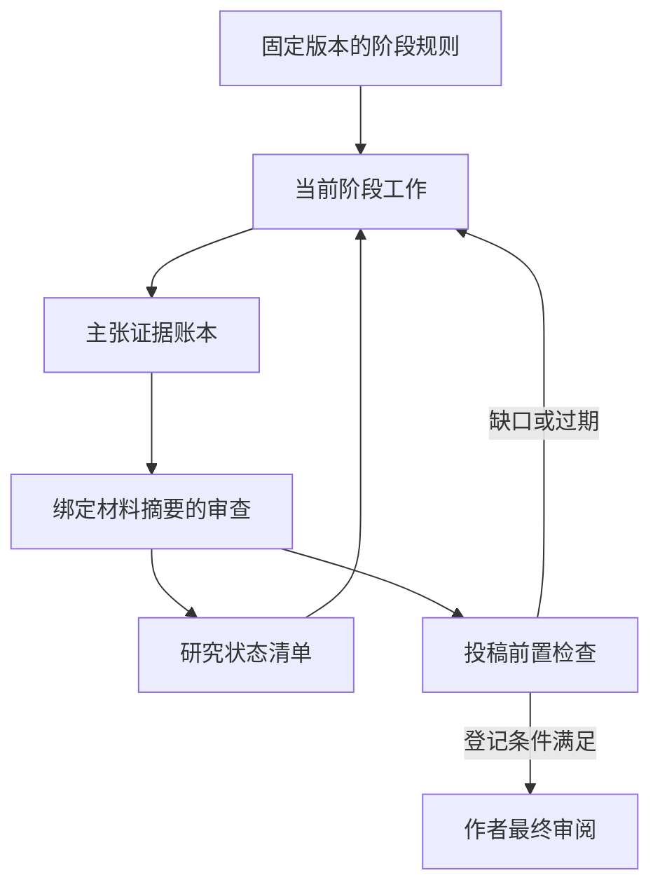

# 科研工作流使用说明

将 [academic-research 入口正文](../bootstrap/academic-research.md) 复制到目标 ChatGPT 项目指令。该入口读取 main 上的 preview 频道，随后把规则、模板和阶段 skills 固定到同一源 SHA。运行中的任务保持原快照。

## 阶段选择

| 本次目标 | mode | 核心交付 |
| --- | --- | --- |
| 收敛研究问题 | scope | 可证伪问题、假设、反证与验证计划 |
| 文献、引用或创新比较 | literature | 文献矩阵、存在性与支持性检查、检索边界 |
| 检查模型与公式 | math | 条件、推导、量纲、反例与验证记录 |
| 设计或验证实验 | experiment | 对照、消融、实际运行证据与复现状态 |
| 提纲、写作或排版 | write | 有证据支持的稿件及材料缺口 |
| 评审、回应与修订 | review | 定位问题、修订对照与断言漂移检查 |
| 检查投稿前置条件 | submission | 当前证据、适用规则、阻断与待核实项 |
| 尚不能确定阶段 | select-stage | 材料盘点与下一阶段 |
| 明确要求端到端推进 | pipeline | 盘点后逐阶段加载与交接 |

宿主根据明确请求选择阶段，CLI 使用 --mode 接受这个选择。CLI 未指定 mode 时只进入 select-stage，不靠“论文”“实验”等词自动猜测。已有明确请求但缺材料时，保留阶段并说明缺口。

```sh
python -m router packet --project academic-research --mode math \
  --task '检查当前优化推导的唯一性与边界条件' --capability github-read
```

数学和实验阶段的 code-execution、artifact-read 是可选能力声明。缺少时可继续分析和设计，数值验证或复运行保持 not-run。声明能力不能证明工具实际可用、文件可读或工作已执行。

## 数据与验证



项目路由维护方法；各研究项目保存材料。每项研究使用 research_id，状态清单记录工作流 SHA。主张有稳定 ID，证据指向实际取得的来源、证明、数据或运行记录。三个记录示例及完整契约见 [模板](../templates/academic/README.md) 和 [科研状态契约](../workflows/academic-state.md)。

`academic-check` 只读检查显式研究根目录中的文件。它核对研究 ID、源 SHA、摘要、审查输入绑定和已登记主张的检查覆盖。文件修改后，旧审查可能成为 stale；只更新清单中的文件摘要不会刷新审查。复核后追加相同检查且覆盖旧主张范围的 supersedes 记录，保留历史。撤回主张通过 withdrawn 和撤回理由记录，不删除历史 ID 与证据。

一致性检查可以通过，而投稿前置检查仍被 unknown、未运行、过期、未解决失败或缺失记录阻断。阶段 complete 也不能替代投稿检查。通过 `--submission` 最多输出 eligible-for-human-review，scientific_truth 始终为 not-verified。

新增主张和证据时，旧审查会因输入摘要变化而过期，保留其历史范围。新材料不会追溯改变旧记录的契约要求；复核后追加覆盖当前输入的 supersedes 记录。这个完整过程可用 `python evals/run_academic_lifecycle.py` 在隔离的合成研究中重放。

投稿检查覆盖所有已登记主张。存在性与支持性、数学、实验和检索边界按主张类型检查；coverage、原创性、期刊合规、修订问题处理检查整份已登记材料。不适用项需要当前账本绑定和理由。登记覆盖不证明全文语义完整，也不能证明作者或工具真的做过被记录的工作。

## 验证与边界

静态测试验证路由、工具依赖、字节预算、ID 与摘要机械关系。独立任务探针检查技能在合成样例中的实际产物。真实 Work 新建对话、跨会话恢复、上下文压缩、私有材料与真实论文仍需要单独验证，按 [Work 验收](WORK_ACCEPTANCE.md) 记录。

科研技能由本仓库独立编写，设计来源、固定 ARS 提交及许可记录见 [参考清单](../registry/academic-references.yaml)。未加入外部模型服务、固定多 agent 拓扑或专业查重系统。运行时需要这些能力时，以实际工具、用户授权和当前期刊要求为依据。
