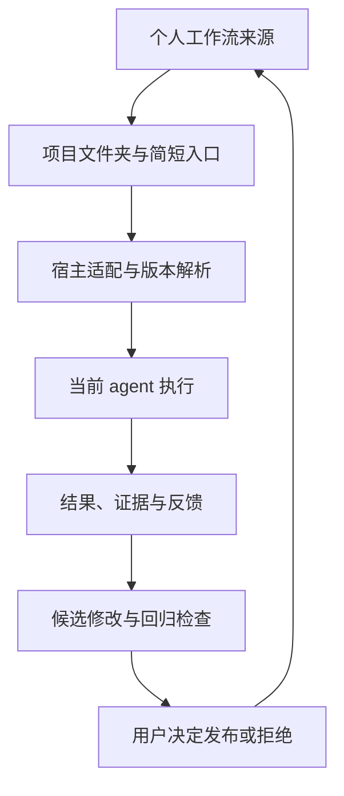

# 个人 AI 工作流管理器 PRD

版本：v0.1 · 日期：2026-10-26（Asia/Shanghai）

产品代号：Personal Workflow，正式名称待定。

状态：访谈综合稿。个人定位与核心目标已确认；文中标为“方案建议”的范围和契约用于评审，不能视为用户已批准的实现方案。

Triage：`ready-for-agent`，仅适用于本文已明确范围的兼容性验证和后续任务拆解。完整产品开发仍受第 12 节未决项约束。本文件归档于仓库 docs，供后续开发引用；归档不代表未决方案已获批准，也不代表产品已实现或发布。

编制方法：当前环境的 `matt-skills-curated` v1.1.0 中 `to-spec` 技能。按已有访谈和代码事实综合，包含完整用户路径、模块契约、外部测试接口和明确的范围排除。该发行包声明上游为 Matt Pocock 的 skills；它属于 curated 版本。

## 1. 产品概述

### 1.1 一句话定位

帮助个人把自己的 AI 工作方法长期保存在外部，在更换 agent 时通过简短入口继续使用，并通过可检查、可回滚的反馈循环持续改进。

### 1.2 核心体验

用户创建项目文件夹，选择已有工作流，将对应简短入口设置到目标 agent 的项目指令中。agent 读取指定工作流版本并执行任务。工作方法集中在外部维护，项目入口无需随每次内容更新重复修改。

迁移目标是延续工作方法。不同 agent 的输出可以存在差异，但必须满足同一工作流声明的关键要求。产品不能承诺所有 agent 天然兼容或产生相同结果。

### 1.3 三个价值闭环

| 闭环 | 用户价值 | 完成条件 |
| --- | --- | --- |
| 迁移 | 更换工具时减少重新配置和重新解释 | 同一工作流在两个经过验证的 agent 环境中完成代表任务，版本和结果可核对 |
| 改进 | 一次有效纠错改善后续任务 | 反馈形成候选修改，通过检查并发布后，新任务使用该修改 |
| 恢复 | 更新出错时保有控制权 | 能发现已定义的回归问题，并将后续新任务恢复到已知版本 |

## 2. 访谈结论、事实与假设

### 2.1 已确认的用户要求

以下 U 编号来自本轮用户明确陈述，优先级高于前序讨论中的团队产品建议。

| ID | 要求 | 产品含义 |
| --- | --- | --- |
| U1 | 产品面向个人使用 | 首版不围绕组织采购、团队审批或企业治理设计 |
| U2 | 希望能够迁移到不同 coding agent | 工作流内容与具体宿主分离；兼容性按宿主和版本验证 |
| U3 | 创建文件夹并设置 bootstrap 下对应项目的简短入口即可开始 | 接入过程尽量短；无需在各工具内复制和维护完整工作流 |
| U4 | 个人工作流可以长期在外部管理 | 外部来源是方法的持续维护位置，agent 是使用位置 |
| U5 | 反馈循环支持迭代和自我改进，让工作流长期健康成长 | 反馈、变更、验证、发布和回滚必须形成可追踪闭环 |
| U6 | 将本次访谈转为 PRD | 本轮产出规范，不开始产品实现 |

“自我改进”在本稿中指系统能够辅助发现问题、提出修改和执行检查；用户尚未确定自动发布程度。

### 2.2 方案建议，尚未成为用户决策

- 延续现有 Git 仓库作为首版工作流来源，不先建设独立托管平台。
- 采用轻量宿主适配层，统一方法定义，适配不同入口和读取能力。
- 首个兼容性里程碑验证两个实际 coding agent；具体产品、版本和运行方式待选择。
- 优先验证方法迁移；完整任务材料、聊天记录和进行中任务的跨工具迁移延后。
- 实质性规则修改先形成候选，用户审阅后发布；允许未来引入有明确范围的长期授权。
- 先覆盖现有内容创作和项目调研中的代表任务，保留科研流程的既有能力和边界。

### 2.3 当前代码事实

本次代码检查固定到 `hilt21/project-router` 的提交 `00c3e84981bbf5cddb4a7ea120750309b40ca714`。这是检查基线，不表示所有频道当前都指向该提交。

| 已有能力 | 实现或文档 | 实际边界 |
| --- | --- | --- |
| 短入口、频道、固定源 SHA | `bootstrap/`、`docs/PROTOCOL.md` | 当前入口面向 ChatGPT Work；其他宿主尚不能据此宣称兼容 |
| 路由、模式与依赖编译 | `router/core.py`、`router/cli.py` | `plan` / `packet` 编译本地工作树，不联网、不执行业务任务 |
| 配置、依赖、锁文件检查 | `validate`、`lock --check` | 静态通过不等于实际行为正确 |
| 发布记录与频道切换 | `release-create`、`promote` | 当前代码提供发布原语；真实运行验收和审阅仍须单独落实 |
| 回执结构检查 | `receipt-check` | 拒绝部分证据误报，但不证明证据真实性 |
| 反馈草稿 | `feedback-draft`、`feedback/README.md` | 当前只生成正文，不自动提交或发布修复 |
| 路由评测和故障测试 | `evals/`、`tests/` | 确定性测试不证明跨 agent 效果或工作流净收益 |

本次读取并分析了代码与测试，未重新运行产品测试。已有真实 Work 记录仅支持其明确列出的限定场景。

### 2.4 待验证的商业与效果假设

- 用户频繁使用多种 agent，或新建多个项目，因而承受重复配置成本。
- 外部统一维护能够减少重复解释和重复纠错，且收益大于维护成本。
- 用户愿意让真实任务中的纠错进入可审阅的反馈循环。
- 有用户愿意为适配、同步、版本比较和持续维护付费。

这些假设没有被本轮访谈或当前仓库测试证明；定价、市场规模和留存率均不作事实声明。

## 3. 问题、用户与解决方案

### 3.1 问题

个人在不同 agent 和项目中积累工作指令。方法随使用逐渐完善，但分散副本难以同步；换工具时需要重新解释；重复问题难以转成长期改进；更新后也难以判断哪些结果受影响。

主要损失包括配置时间、纠错时间、审核时间，以及对方法是否实际加载和生效的不确定性。

### 3.2 目标用户

首批用户画像为经常使用 agent 的个人知识工作者，包括工程师、研究者和内容创作者。用户希望保留自己的方法，并愿意维护少量项目入口。画像是本稿用于验证的选择，尚无市场访谈证明。

同一个人同时承担工作流使用者、维护者和发布决策者。产品不为这些角色引入团队权限层级。

### 3.3 解决方案

在外部保存版本化工作方法；在项目文件夹保留轻量绑定；由宿主适配层读取可信快照；通过任务产物和可观察记录核对结果；将实质反馈转成最小候选修改；在检查后发布并支持恢复。

项目材料与任务状态独立保管。它们不会因被读取而成为工作流规则，也不默认上传到外部方法仓库。

## 4. 用户故事

按 `to-spec` 的统一句式列出故事。编号供功能、验收和后续开发任务引用；故事覆盖拟议 MVP 的成功、异常和退出路径。

1. **US-01** As an individual user, I want to select an existing workflow, so that I can reuse a method I already trust.
2. **US-02** As an individual user, I want to bind a new folder with a short entry instruction, so that I can start without copying the full workflow.
3. **US-03** As an individual user, I want my existing project instructions preserved, so that setup does not erase my work.
4. **US-04** As an individual user, I want setup to check whether my chosen agent can use the workflow, so that I know what will work before starting.
5. **US-05** As an individual user, I want to understand missing access or tools, so that I can fix the specific problem without guessing.
6. **US-06** As an individual user, I want to choose a task or stage within a workflow, so that the agent uses the relevant instructions.
7. **US-07** As an individual user, I want to see the workflow version used for a task, so that I can trace unexpected results.
8. **US-08** As an individual user, I want an ongoing task to keep its workflow version, so that an external update does not change its behavior halfway through.
9. **US-09** As an individual user, I want to use the same workflow in another supported agent, so that I can change tools without rebuilding my method.
10. **US-10** As an individual user, I want new tasks to receive published workflow updates without editing every entry, so that maintenance stays centralized.
11. **US-11** As an individual user, I want unavailable sources or damaged workflow files to be reported clearly, so that I do not mistake an incomplete setup for a working one.
12. **US-12** As an individual user, I want to see completed checks and unresolved gaps, so that I can judge whether the result is ready to use.
13. **US-13** As an individual user, I want to capture a correction with its task context, so that I do not have to explain the same failure repeatedly.
14. **US-14** As a workflow maintainer, I want temporary requests separated from lasting preferences, so that one task does not silently change my future work.
15. **US-15** As a workflow maintainer, I want failures classified before rules are changed, so that tool problems do not create unnecessary instructions.
16. **US-16** As a workflow maintainer, I want to review a proposed change and its scope, so that I understand what future behavior will change.
17. **US-17** As a workflow maintainer, I want to compare a candidate with the current version using the same examples, so that I can detect improvements and regressions.
18. **US-18** As a workflow maintainer, I want to accept, revise, postpone, or reject a proposed change, so that I retain control over my methods.
19. **US-19** As a workflow maintainer, I want a release linked to its feedback and checks, so that I can understand why it was published.
20. **US-20** As a workflow maintainer, I want to restore a known version, so that I can recover when an update causes problems.
21. **US-21** As a workflow maintainer, I want conflicting or overlapping changes to be surfaced, so that my workflow does not accumulate incompatible instructions.
22. **US-22** As an individual user, I want private materials and credentials excluded from shared feedback, so that improving a workflow does not expose my data.
23. **US-23** As an individual user, I want project materials kept separate, so that using one shared method does not mix unrelated tasks.
24. **US-24** As an individual user, I want to inspect and export my workflow files, so that I can continue using my methods if I leave the product.
25. **US-25** As an individual user, I want to remove a project binding safely, so that I can stop using the workflow without losing project files.
26. **US-26** As an individual user, I want interrupted feedback or publishing steps to be recoverable, so that retrying does not duplicate changes or falsely report success.
27. **US-27** As a workflow maintainer, I want previously useful rules to be simplified or retired, so that the workflow remains understandable over time.
28. **US-28** As an individual user, I want execution failures to remain visible even when no feedback is submitted, so that incomplete records do not suggest that everything succeeded.

## 5. 功能需求与验收标准

P0 表示本稿建议的 MVP 必须形成闭环的能力。优先级是规范建议，尚未构成开发授权。表中的“必须”是拟议产品验收要求。

| ID | 功能与故事 | 关键要求 | 可观察验收 |
| --- | --- | --- | --- |
| FR-01 P0 | 工作流选择与绑定，US-01～03 | 绑定来源、工作流、频道和宿主；保留既有项目内容 | 新文件夹接入成功；重复操作不复制重复入口；遇已有冲突入口展示差异，不静默覆盖 |
| FR-02 P0 | 兼容性诊断，US-04～05 | 区分读取能力、业务工具能力、权限与未验证项 | 缺必要读取能力时停止依赖步骤并解释原因；缺可选工具时允许独立工作且标记未运行 |
| FR-03 P0 | 选择阶段与加载，US-06 | 按项目与显式阶段加载公共和当前模式依赖 | 执行包不混入其他项目规则；意图不清时进入盘点；明确阶段但缺材料时保留阶段并列材料缺口 |
| FR-04 P0 | 版本一致性，US-07～10 | 新任务解析频道后固定 SHA；继续任务沿用原 SHA | 发布过程中旧任务继续使用旧 SHA；新任务使用新发布 SHA；正常内容更新无需修改入口 |
| FR-05 P0 | 加载失败处理，US-11 | 截断、读取失败、摘要不符均不能算加载成功 | 断链和校验失败显示明确原因；不回退到任意版本、不偷偷修改锁文件；缺少摘要能力标记未验证 |
| FR-06 P0 | 结果回执，US-12、28 | 记录来源、宿主、实际检查、证据和缺口 | 自述不独立构成 passed；静态 ready 不显示为任务完成；中断或反馈缺失保留 unknown/partial 等真实状态 |
| FR-07 P0 | 反馈采集与分类，US-13～15、22 | 保存观察、预期、版本、作用范围和脱敏证据 | 临时要求不自动升级为长期规则；根因不明可保留 unknown；提交前可查看拟上传内容 |
| FR-08 P0 | 候选修改，US-16、18、21、27 | 生成最小变更及理由，允许编辑、延期、拒绝；支持删减和合并规则 | 候选不影响正式频道；用户可核对差异、影响项目和待检查项；有冲突时不自动合并发布 |
| FR-09 P0 | 回归比较，US-17 | 同一输入比较当前与候选；包含失败复现和反例 | 记录输入、版本、产物、宿主与检查口径；未运行的行为检查明确标记；不以静态检查或模型自评分替代 |
| FR-10 P0 | 发布与恢复，US-19～20、26 | 发布绑定不可变源与验证记录；重试有明确结果；检测过期候选 | 正式频道只能指向与检查相符的候选；并发更新后拒绝覆盖未知新版本；回滚保留历史并影响后续新任务 |
| FR-11 P0 | 隐私与项目隔离，US-22～23 | 方法、项目材料和凭据分离；外部写入遵守实际授权 | 合成私密样例不会进入公开反馈；跨项目材料不进入另一项目执行包；无法证明宿主记忆隔离时不得声称完全隔离 |
| FR-12 P0 | 可退出，US-24～25 | 保留可读文件和版本信息；安全解除绑定 | 导出不依赖专有服务才能阅读；解绑仅移除产品管理的入口内容，不删除用户项目、原始方法或历史产物 |

入口协议升级可能需要更新入口，必须展示受影响绑定及迁移说明。“内容更新无需重配”不扩展为“入口永远无需升级”。

## 6. 关键用户流程

### 6.1 首次使用

1. 用户准备或选择个人工作流来源。
2. 用户创建项目文件夹并选择对应工作流。
3. 产品提供目标宿主的简短入口和放置说明；自动写入仅在宿主有相应能力且用户授权时执行。
4. 产品或宿主检查来源可读性、版本解析、必要能力和入口冲突。
5. 用户启动代表任务，取得可核对的结果与回执。

失败出口：来源不可读、项目未知、宿主未验证、依赖缺失或入口冲突。每种失败说明受阻步骤和恢复动作，不要求用户复制整套方法作为常规方案。

### 6.2 迁移到另一个 agent

使用同一方法来源与工作流，在目标 agent 设置相应入口。检查实际能力，按固定快照运行代表任务。结果按相同要求验收，并记录工具或模型差异。

本路径迁移工作方法。没有明确材料交接时，不声称已经恢复原聊天、原任务进度或所有历史决策。

### 6.3 一次纠错进入下一版

任务产生实质反馈 → 保存观察和预期 → 判断临时要求、偏好、规则或环境问题 → 提出候选差异 → 比较旧版与候选 → 用户决定发布、修订或拒绝 → 发布后以新任务核对效果。

已有会话内反馈可直接整理为草稿。将其写入外部来源与发布正式版本分别判断授权，仓库规则本身不授予权限。

### 6.4 新版退化与恢复

记录退化样例和对应版本 → 复现并检查影响范围 → 用户选择已知版本 → 以新的历史记录切换频道 → 验证新任务解析结果。进行中任务保留原快照，除非用户明确决定升级或重开任务。

## 7. 架构与实现决策

### 7.1 边界

产品管理工作方法、分发和改进证据。实际任务由当前 agent 及其工具执行。指令无法强制宿主遵守规则；权限和高风险动作限制仍依赖实际执行环境。

### 7.2 模块边界

| 模块 | 职责 | 复用与变化 |
| --- | --- | --- |
| 工作流定义与编译 | 项目、模式、依赖、锁文件、执行包 | 复用 `router/core.py`，继续保持纯编译与检查边界 |
| 来源解析与读取 | 将频道解析到快照，读取该快照内的必要文件 | 当前由宿主执行；增加跨宿主约定，具体读取适配待验证 |
| 宿主适配与项目绑定 | 入口生成、冲突检测、能力说明与绑定诊断 | 新增；工具差异不得复制成多份独立工作流 |
| 回执与证据 | 记录身份、检查、产物引用和未验证项 | 复用 `receipt-check`；扩展宿主与绑定关联时保持 schema 兼容 |
| 反馈与候选 | 分类、脱敏、最小变更、用户决定 | 复用 `feedback-draft`；补齐候选生命周期和关联 |
| 回归与发布 | 比较、审阅、发布、回滚与并发防护 | 复用现有发布原语，补齐产品层的证据与过期候选门槛 |

本稿不引入模型代理、通用 agent 执行引擎或数据库服务。管理 UI、桌面端、CLI、MCP 等交互形式见未决项。

### 7.3 逻辑对象与数据契约

下表定义需求级契约；新增对象的物理文件名、存储格式和具体接口命名由后续实现设计确定。已有对象的字段以当前代码为准。不得把逻辑对象名称解释为已存在的 API。

| 对象 | 必要信息 | 不变量 |
| --- | --- | --- |
| 工作流来源 | 可信仓库或来源标识、工作流目录、访问方式 | 凭据不进入入口或工作流正文；更换来源需明确可见 |
| 项目绑定 | 绑定标识、项目实例、现有 project_id、来源、频道、宿主、入口协议版本 | 当前 project_id 表示路由身份，不能独自隔离多个同类项目文件夹；项目实例需独立标识 |
| 发布快照 | 版本、完整 commit_sha、路由映射、依赖与内容摘要 | 已发布快照不可变；内容修改需要新版本 |
| 执行上下文与回执 | run_id、绑定关联、project_id、mode、snapshot_sha、宿主及可知版本、读取与验证记录、unverified | 读取未知和未运行保持显式；源码身份与业务完成状态分开 |
| 反馈记录 | 反馈标识、来源任务与版本、观察、预期、分类、作用范围、脱敏证据、当前状态 | 暂时要求不自动进入全局规则；根因未知可以保留 |
| 候选变更 | 候选标识、基线 SHA、变更差异、影响范围、关联反馈、检查结果、用户决定、发布或回滚关联 | 检查必须对应实际候选；候选修改后旧检查不得直接沿用为通过 |
| 兼容性记录 | 宿主、版本或 unknown、入口方式、读取方式、能力、样例与证据、验证日期和局限 | 已读入口、完成任务、满足质量要求分别记录；只对实际测试组合声明支持 |

扩展现有回执时，先定义读写双方兼容规则；不能直接要求旧 `schema_version: 1` 消费方接受新的完成语义。

### 7.4 外部行为接口

| 行为 | 输入 | 输出或副作用 | 失败约定 |
| --- | --- | --- | --- |
| 生成/安装入口 | 绑定配置、目标宿主、项目位置、已有入口 | 简短入口、差异及诊断；安装有授权时写入 | 冲突不覆盖；重复安装可识别 |
| 解析工作流 | 绑定、任务是否继续、已有快照、选定模式 | 固定快照和加载清单；可交给现有 plan/packet | 来源错误、缺必要依赖或内容不完整时报告 blocked/error |
| 记录反馈 | 回执、观察、预期、分类、范围 | 可审阅反馈草稿 | 敏感内容不提交；未知原因不强行归类 |
| 检查候选 | 基线、候选、固定输入、目标宿主与检查集合 | 逐项结果、证据和未验证项 | 无执行能力时保持 not-run；过期结果不得用于发布 |
| 发布/回滚 | 明确目标快照、当前预期频道值、授权和证据 | 新历史记录及可回读的频道状态 | 并发冲突、授权不足或检查不符时不成功切换 |

保留现有 CLI 的返回码边界：0 表示相应静态操作或执行包就绪，1 表示配置/读取等错误，2 表示能力缺口、需要输入或评测失败。产品展示不得把 0 统一翻译成“任务完成”。新增操作的具体返回码需在实现规范中定义。

### 7.5 状态和一致性

- 绑定诊断建议使用 ready、needs-input、blocked、unknown；ready 仅代表接入条件满足。
- 执行与验证沿用当前协议和回执已有状态，不将诊断状态混入完成状态。
- 反馈依次经历记录、分类、候选、检查、待决定和已发布；也可以拒绝或延期。检查失败、缺证据和候选过期必须可区分。
- 发布时核对候选基线、实际检查对象和当前频道；若当前频道已被另一次更新改变，先重新评估差异。
- 外部写入超时后先回读是否成功。确认状态后再重试，避免重复提交或重复发布。
- 对来源暂时不可用的任务，本稿不承诺离线运行；如未来使用缓存，必须标明确切快照和完整性，不静默使用过期来源。

## 8. 非功能要求

| 维度 | 要求 |
| --- | --- |
| 便携性 | 完整方法采用可阅读、可导出的文件；宿主差异限制在适配层 |
| 安全与隐私 | 凭据由宿主或专用凭据机制提供；不默认采集完整聊天；项目材料不默认公开；研究材料不得变成指令来源 |
| 可追溯性 | 每次运行和实质修改可关联方法版本；证据缺口显式可见 |
| 易用性 | 正常内容更新不要求逐项目编辑入口；错误提示说明失败步骤、影响和下一步 |
| 可维护性 | 检查重复、冲突、失效依赖；允许删除和简化规则；保留锁文件与上下文预算检查 |
| 可恢复性 | 发布历史保留；频道回滚可验证；失败重试不得造成静默覆盖 |
| 执行成本 | 只加载当前任务需要的依赖；记录可获得的加载成本。延迟、费用和可用性 SLA 在首轮测量前不作数字承诺 |

## 9. 测试策略与验收接口

遵循 `to-spec` 的最高层可用接口原则。新增行为优先从公开 CLI、真实文件与 Git 仓库、实际 agent 入口验证。保留有价值的既有测试，不为测试而新增大量内部可替换接口。

### 9.1 证据分层

1. 静态与完整性：依赖、路径、锁文件、预算、协议结构。
2. CLI 集成：真实临时仓库、命令返回码、执行包、发布与回滚副作用。
3. 宿主行为：真实项目入口读取、固定版本、缺能力处理和实际产物。
4. 用户效果：人工纠错时间、重复问题、持续使用和主观负担。

第 1、2 层通过不能替代第 3、4 层。不能以 agent 自述为唯一行为证据，也不能以单次好结果推断普遍质量提升。

### 9.2 必须覆盖的验收场景

| ID | 场景与预期 | 关联需求 | 验证位置 |
| --- | --- | --- | --- |
| AT-01 | 新文件夹绑定后可读取正确工作流；重复安装不重复；旧内容保留 | FR-01 | 项目文件差异、适配入口集成 |
| AT-02 | 两个目标 agent 使用同一快照完成相同代表任务，逐项核对产物要求 | FR-02～04 | 两个真实宿主；记录版本和局限 |
| AT-03 | 来源无权限、断链、截断或校验失败均不冒充已加载；补齐条件后可重试 | FR-02、05 | 读取适配边界及至少一个真实失败案例 |
| AT-04 | 仅当前模式依赖加载；缺必要工具阻塞，缺可选工具保留独立工作 | FR-02～03 | CLI 和宿主任务 |
| AT-05 | A 任务锁定旧版，频道更新后 A 不混版，新任务 B 使用新版 | FR-04 | 真实 Git 发布及宿主回执 |
| AT-06 | 自述通过、空证据和未知来源不能显示为可信完成；中断保留真实状态 | FR-06 | receipt-check 与界面/文本呈现 |
| AT-07 | 临时要求、长期偏好、工具故障、规则问题与未知原因分别处理 | FR-07 | 反馈草稿和候选差异 |
| AT-08 | 一次真实纠错生成最小候选，旧版复现问题，候选通过对应检查及反例 | FR-08～09 | 固定输入、实际产物与检查证据 |
| AT-09 | 用户拒绝或延期后正式版本不变；共享规则冲突清楚可见 | FR-08 | 实际文件与发布记录 |
| AT-10 | 检查后修改候选、基线过期或并发更新时，原通过结果不能直接发布 | FR-09～10 | CLI/发布适配集成 |
| AT-11 | 发布回读可核对；模拟退化后恢复旧版，新任务解析正确；中断重试不重复 | FR-10 | 真实临时 Git 仓库与宿主 |
| AT-12 | 合成私密内容不进入外部反馈；两个同类项目不串材料 | FR-07、11 | 待提交负载检查与两个真实项目 |
| AT-13 | 导出文件可独立阅读；解绑只移除受管入口；未知宿主不宣称支持 | FR-02、12 | 文件检查与目标入口 |
| AT-14 | 规则可删减；无实质反馈不会自动追加规则；重复反馈可关联已有候选 | FR-07～08 | 候选记录、差异及回归结果 |

现有仓库要求的 validate、lock --check、eval 与单元测试继续作为行为修改提交的必要检查。新增适配层的真实宿主验收必须单列，不能用这些检查替代。

## 10. 成功指标与验证设计

### 10.1 产品成功指标

| 指标 | 定义 | 本稿处理 |
| --- | --- | --- |
| 接入完成率 | 完成代表任务的有效接入次数 / 实际接入尝试次数 | 按宿主记录失败与阻塞，不只统计成功 |
| 接入耗时 | 从准备来源和文件夹到首个可核对任务结果的时间 | 区分初次授权、方法准备和重复迁移 |
| 重复纠错率 | 已登记并修复的问题在后续相关任务中再次出现的比例 | 明确问题 ID 和适用任务集合 |
| 人工监督耗时 | 每任务人工补充解释、修改和审核所用分钟数 | 同时记录方法维护耗时 |
| 反馈闭环率 | 已验证生效的改进 / 被接受为应修复的问题 | 延期、拒绝、环境问题单独统计 |
| 持续使用 | 用户跨周使用已发布工作流的情况 | 不等同于付费意愿 |

除必须通过的功能验收外，暂不把数值阈值写成已确认目标。前序建议的“下降约 30%”仅为可讨论实验目标，本稿不将其升级为验收承诺。

### 10.2 净收益实验建议

在同一类任务上比较：A 用户原做法；B 一份整理良好的完整指令；C 外部管理、短入口和反馈机制。尽量固定材料、宿主和模型条件，重复运行并记录波动。

B 组用于区分整理方法本身的收益与管理层的额外收益。跨 agent 兼容性验证单独进行，避免把模型差异误归因于管理产品。

本轮不运行该实验。用户数量、任务数量、成本预算和具体通过门槛在实验设计时确定。

## 11. 交付阶段与范围排除

### 11.1 建议交付顺序

| 阶段 | 交付 | 退出条件 | 前置决策 |
| --- | --- | --- | --- |
| M0 兼容性验证 | 两个目标 coding agent 的入口、读取与能力记录 | AT-02 的限定验证及失败说明齐全 | 首批宿主、版本和环境 |
| M1 方法迁移 | 绑定、诊断、固定快照、回执、解绑 | FR-01～06、12 对目标组合通过 | 入口写入方式、第一交互界面 |
| M2 改进闭环 | 反馈、候选、回归、用户决定与发布关联 | 至少一个真实问题完成 AT-07～10 | 反馈存放位置和发布授权策略 |
| M3 退化恢复与个人试用 | 回滚、冲突处理、隐私检查及效果记录 | AT-11～14 通过，开始积累效果数据 | 私有来源接入方式、试用计划 |

阶段编号属于本产品规划，不对应其他项目中相同名称的里程碑。

### 11.2 首版范围外

- 团队权限、组织审批、企业 SSO、多租户治理和企业采购功能。
- 技能交易市场、作者分成和公开方法商店。
- 通用 agent 执行平台、模型流量代理或模型训练。
- 自动迁移全部聊天、业务材料、长期记忆及进行中任务状态。
- 对所有 agent、所有版本、所有工作流的无条件兼容声明。
- 无用户策略约束的自动全局改写、自动发布和自动扩大作用范围。
- 保证模型逐条服从指令，或仅凭指令强制阻止工具动作。
- 自动安装传递依赖、自动获取凭据、改变宿主权限或绕过访问限制。
- 离线缓存策略、云端托管控制台、计费订阅、移动端和复杂可视化编排。

后三类产品形态可在后续评估；本稿不据此否定长期外部管理能力。外部 Git 仓库足以作为首轮验证来源。

## 12. 未决项与决策边界

| ID | 未决项 | 已知约束 | 何时必须决定 |
| --- | --- | --- | --- |
| O1 | 首批两个 coding agent 及其版本 | 面向跨工具使用；不能以 ChatGPT Work 单一验收替代 | M0 开始前 |
| O2 | 第一交互形式与自动配置程度 | 文件夹加短入口；保留用户既有内容 | M1 实现前 |
| O3 | 个人外部来源及私有仓库访问方式 | Git 可复用；当前仓库公开，不能放入个人秘密 | 读取适配实现前 |
| O4 | 反馈记录与候选修改存放位置 | 工作方法外部维护；不默认上传完整聊天 | M2 实现前 |
| O5 | 用户对发布的授权策略 | 自动建议可作为目标；自动发布尚未获得明确产品决策 | M2 发布行为实现前 |
| O6 | 多个同类项目的实例标识与回执 schema 演进 | 当前 project_id 是路由身份，需避免材料串用 | 绑定与回执契约实现前 |
| O7 | 正式名称、定价和付费功能 | 个人优先；愿付费尚未验证 | 商业试用前，不阻塞核心技术验证 |

可独立推进的下一步是依据 O1 形成一张兼容性验证表，再拆解 M0；本文不替用户选择宿主，也不把未决项悄悄固化进代码。

## 13. 来源与可复核说明

### 13.1 访谈来源

本对话中用户关于商业价值的提问、对个人方向的明确修正，以及使用 `to-spec` 生成 PRD 的要求。用户明确要求见 U1～U6。助手提出的产品范围、适配方案和验证方法均已单独标为方案建议。

本稿没有把前序团队优先建议保留为产品目标；没有把用户未明确确认的价格、技术栈或界面形态写成决策。

### 13.2 代码来源

以下链接固定到本次检查基线，避免后续 main 更新改变本稿所依据的事实。

- [README](https://github.com/hilt21/project-router/blob/00c3e84981bbf5cddb4a7ea120750309b40ca714/README.md)
- [仓库约束](https://github.com/hilt21/project-router/blob/00c3e84981bbf5cddb4a7ea120750309b40ca714/AGENTS.md)
- [架构与边界](https://github.com/hilt21/project-router/blob/00c3e84981bbf5cddb4a7ea120750309b40ca714/docs/ARCHITECTURE.md)
- [加载与证据协议](https://github.com/hilt21/project-router/blob/00c3e84981bbf5cddb4a7ea120750309b40ca714/docs/PROTOCOL.md)
- [CLI 接口](https://github.com/hilt21/project-router/blob/00c3e84981bbf5cddb4a7ea120750309b40ca714/router/cli.py)
- [编译、验证、发布与回执实现](https://github.com/hilt21/project-router/blob/00c3e84981bbf5cddb4a7ea120750309b40ca714/router/core.py)
- [反馈闭环](https://github.com/hilt21/project-router/blob/00c3e84981bbf5cddb4a7ea120750309b40ca714/feedback/README.md)
- [回执示例](https://github.com/hilt21/project-router/blob/00c3e84981bbf5cddb4a7ea120750309b40ca714/templates/receipt.example.json)
- [评测分层](https://github.com/hilt21/project-router/blob/00c3e84981bbf5cddb4a7ea120750309b40ca714/evals/README.md)
- [路由与发布测试](https://github.com/hilt21/project-router/blob/00c3e84981bbf5cddb4a7ea120750309b40ca714/tests/test_router.py)
- [模式依赖测试](https://github.com/hilt21/project-router/blob/00c3e84981bbf5cddb4a7ea120750309b40ca714/tests/test_modes.py)

### 13.3 技能来源

实际使用环境中 `matt-skills-curated/1.1.0/skills/to-spec/SKILL.md`。发行包的 `source-provenance.json` 声明上游仓库为 [mattpocock/skills](https://github.com/mattpocock/skills)，上游提交为 `6654f6b60cd9d5be8b54c6fafe44346dabeb3b76`，维护者为 Mamdouh Aboammar。本次读取了本地 curated 技能与来源声明，未独立比对该上游提交的原文。

### 13.4 本次交付检查

检查范围：用户要求可追踪性、用户故事完整性、需求与验收映射、既有能力与拟议能力区分、未决项、范围排除、文档结构及引用格式。

未执行：产品开发、兼容性实验、真实 agent 迁移、模型效果评测、用户付费验证。本文中所有 AT 场景都是未来验收要求，未因写入 PRD 而获得 passed 状态。
